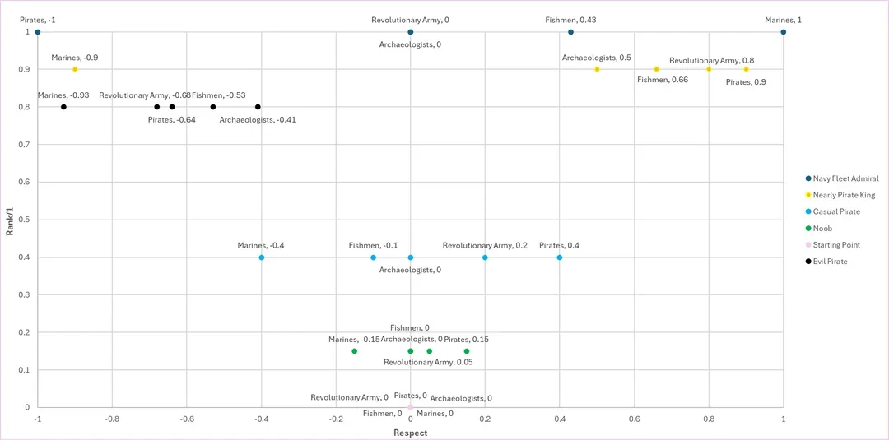
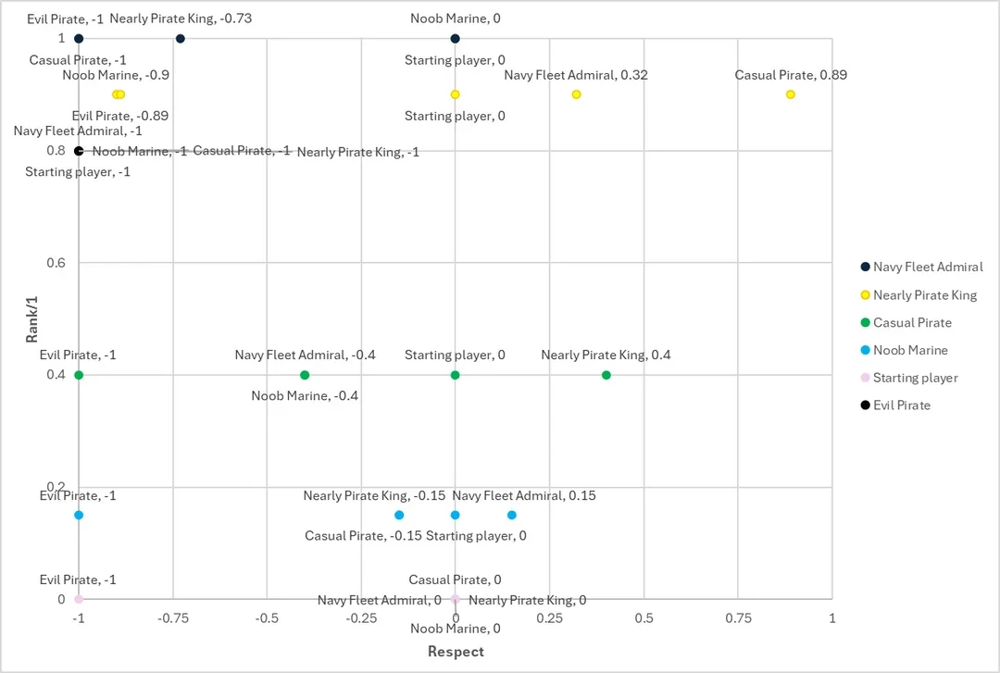

# Redditor idea #1 — the fan-dream One Piece open-world MMO (captured 2026-07-18)

> A Reddit design pitch (r/OnePiece) supplied by the developer: a fan's repeatedly-iterated dream design
> for an official open-world One Piece game, posted publicly and refined across multiple postings.
> Captured as **market evidence and convergence data** — a mainstream fan independently designing toward
> many of openpiece's recorded decisions. Transcribed with original wording (light structure added); the
> post's two respect-graph images are alongside this file (`image.png`, `image-1.png`). The author's own
> market note: a Roblox mod on this premise holds **over 2 million concurrent players**.

## The pitch (author's framing)

> Hi guys I've posted this a couple times but each time someone gives me a cool new idea to work with
> and so I'm just going to keep going until I cannot develop this idea any further. I really believe in
> this game described below so please give some feedback and let me know if you'd play this!!! And with
> a Roblox mod based on this idea having over 2 million concurrent players I find it hard to believe an
> official game like this will not be on the way someday!

## Generalities

- Same/similar art style as One Piece Odyssey.
- Live combat, no turn-based waiting.
- Devil Fruits are rare rewards, semi-permanently affecting the character who consumes one.
- Besides some notable exceptions, only one Devil Fruit can affect each character.
- Multiple recruitable characters, who can be given Devil Fruits.
- Relationships between all important characters.
- Recruited crewmates can leave/betray your crew if you don't maintain relationships.
- "Utilizing AI would not be unrealistic for this game's NPCs."

## Gameplay

- Character creator (young adult) + a chosen **aspiration**: Pirate, Marine, Revolutionary, Bandit,
  Swordsman, Archaeologist, etc. Potential power levels (haki capacity, weapons) set here; each
  aspiration has a range of potentials.
- Combat aspirations start with their weapon and basic moves; non-combat aspirations start with neither
  and acquire them through looting, missions, or masters.
- Reaching max potential requires maxing the skill tree; boosted by using related abilities in
  high-stakes combat.
- Bounty-hunter option for solo players of any aspiration (and a money-earner).
- Introductory tutorial: witnessing Gol D. Roger's execution in Loguetown as a younger version of your
  character.
- Several starting locations by aspiration; all aspirations eventually enter the Grand Line through
  main missions.
- Gradual guided explanation of the many systems.
- (Optionally) receive a basic Devil Fruit early, or hold out for a rarer one.
- Canon events and cutscenes at selected times shape the storyline, "keeping it exciting and accurate
  to One Piece lore." First crew members and first ship acquired through canon events.
- Faction war events for large-scale combat with world-affecting results.
- Weapon/equipment crafting from parts found in the world.
- Join the Navy/Pirates from any aspiration, with undercover double-agent storylines.
- Colosseum battles with increasing difficulty and rewards.
- Build a large alliance and fleet, or focus your crew's strength (probably both): ally strong AI
  crews, befriend characters to recruit them, poach members through friendship, win them in Davy Back
  fights, or intimidate/decimate crews and leave survivors few choices.
- End-game missions greatly affected by alliance and crew strength; in the New World, player-crew
  alliances outweigh most AI allies.

## Starting areas

- **Loguetown** — aspiring Pirate Kings; near the Grand Line entrance.
- **Shell Town Marine Base** — aspiring Navy Admirals; far enough out for low-level learning.
- **Wano** — aspiring World's Greatest Swordsmen; a big starting land inside the New World, leave when
  ready.
- **Ohara** — Archaeologists/Historians (not yet Buster Called on this timeline); early fruit or a tech
  tree to offset weak combat.
- **Secret Base** — Revolutionaries: covert missions, incite rebellions, rise through the ranks.
- **A wild, lawless island** — Bandits: raiding, robbing, gang dominance, mostly land-based.

## Combat

- Dynamic battle arena at each major island (e.g. Dressrosa Colosseum).
- Equip hand-held weapons, fists with trainable Haki, or Devil Fruits that create an equipped weapon.
- Combat/sparring can start at almost any time on almost any character, even at sea.
- Navy-controlled areas send marines to stop combat; World Government agents pursue strong pirates.
- If apprehended with a big enough bounty: Enies Lobby or Impel Down, with escape missions and fights.

## Combat mechanics

- Basic attacks chain into combos; many moves learned from masters.
- Up to 10 equipped combo moves per weapon; stronger moves swap out weaker ones over time.
- Activation costs and cooldowns on certain moves.
- Combos broken at close range by matching the enemy's button: parry/counter/combo-breaker (cannot
  block while attempting).
- Advanced Observation Haki eventually shows the enemy's next button at counter range (countered by
  keeping multiple similar combos or not completing combos immediately).
- Damage types: physical (resisted by armor + Armament Haki), elemental (resisted by elemental
  resistance), and pure (unresistable, set values).
- 1v1 captain duels and Davy Back fights.
- Dishonorable pirates get dirty moves with non-binding results and a subtle badge of dishonor.
- Interactive environmental combat features everywhere; boarding and open-ocean combat at any time.
- Large-scale land and sea battle events, joinable and frequent.
- On death: respawn at a nearby port; loot and unprotected Devil Fruits at risk of plunder.
- A Devil Fruit user in the sea is rescued by non-fruit crewmates.
- Random encounters: rival NPC pirates, marines, mysterious islands.

## Devil Fruits, Haki & weapons

- Fruit effects disappear if you die too many times without completing a refresh task.
- Fruit types alter characters differently: weapon-manifesting (Paramecia), element integration
  (Logia), full transformations (Zoan).
- Fruits and weapons as rare rewards; a limited number protected from plunder; rarity tiers; tradeable.
- Each fruit has its own skill tree with unique (sometimes similar) upgrades; fruit/weapon/haki trees
  unlock moves and combos.
- Possibly only one of each Devil Fruit user per server (or so many fruits that duplicates are rare).
- Trainable Haki balanced against fruits; the strongest Haki requires high-stakes combat.
- **Purists vs versatile builds**: immense power in one or two areas, or versatility across weapon +
  haki + fruit.
- A system of move-type counters.

## Crew & customization

- Recruit generated AND historical characters met on your travels (or battle them).
- Give crewmates Devil Fruits (some initially refuse).
- **Play as any crew member.**
- Full customization for generated recruits; customizable styles for historical ones; customization
  deepens over the game.
- Each aspiration meets its first crewmate through a canon event in its starting area.
- AI-driven NPC personality system: learning behaviors, memories of past player interactions, evolving
  dialogue trees, personality traits that genuinely affect interactions.

## Character traits & skills

- Player characters have traits with max potential set at creation; upgraded toward potential by
  spending belis. Encountered characters have their own potentials.
- Skills (e.g. Conqueror's Haki) taught by masters, trained through use in the open world.
- **Race tokens** intrinsic to characters, influencing relationships and granting bonuses: Humans,
  Animals, Humanoid, Fishmen, Long Arm, Skypieans, Lunarians, Buccaneers, Mink, Seraphim, Cyborgs,
  Giants, Half-Giants, Onis, Tenryuubito, plus regional badge effects.
- Notoriety effects: damage bonuses against high-bounty/high-rank characters.
- Misc bonuses for specific fruits, strong Haki users, and unique/humorous traits.

## Notoriety & respect

- **Notoriety skill tree** unlocks by bounty/rank (raised by rebellious/evil acts): bigger ships,
  restricted areas, stronger weapons and masters.
- **Respect system** affected by moral/story choices and harm to innocents; a spectrum influencing all
  interactions, filtered by region, race, and values.
- Respect direction + bounty level affect the character's aesthetic.
- Bounty can rise from evil acts OR from large good acts that the government/media spins against you
  (like the Straw Hats).
- Global leaderboards per aspiration; top bounties get wanted posters throughout the world for
  everyone to see.
- Main storyline influenced by player choices: unique paths, alliances, endings.
- Two respect-spectrum example graphs:  and
  .

## HUD / menus

- Combat level measured by the Te-Awase technique (CP9's Fukurou); doesn't account for most fruits.
- Inventory, crafting, notoriety/rank, and respect menus from level 1; fruit skill tree unlocks with a
  fruit.
- **Intelligence Level** measures all non-combat levels — visible only to friends/allies or advanced
  Observation users; unlocks on first interaction with a historical object.

## Exploration & navigation

- Physical map + Log Pose on the ship track the journey; **no navigator or Log Pose = no tracking**.
- Real-time historical & fictional events from the manga/anime, experienced by everyone online at once.
- Relationships and crew bonds unlock team strategies and attacks.
- Ship upgrades at checkpoints: larger crew, more roles and features.
- Real-time sailing; navigators with a Log Pose can fast-forward; fast travel between points of
  interest when out of combat, interruptible by NPCs/players/land.
- A journey similar to the Straw Hats', with liberation/control options per region.
- Purchasable/reward Vivre Cards let others track your location.
- Fill a Devil Fruit encyclopedia by encountering or spyglassing fruits and users.

## Islands & environment

- Uniquely explorable islands: environment, culture, challenges; Grand Line islands 100% accurate.
- Dynamic weather and hazards; navigation challenges from real-time weather simulation.
- Unique flora, fauna, economy, and trade per location; black markets for rare goods.
- Fruit powers more/less effective in certain weather.
- Environmental interactions change based on crew composition.
- Dynamic world events trigger missions and unexpected temporary alliances.

## Multiplayer & storyline

- New stories plus under-told storylines fleshed out.
- Eventual all-player crews with assigned roles in the New World; multiplayer main missions;
  large-scale alliance missions ("PEAK").
- Main story leads all aspirations toward the Poneglyphs and Laugh Tale — different reasons, paths,
  and allies.
- Formal alliance mechanics, negotiation minigames, treaty systems, diplomatic reputation separate
  from combat reputation.
- "Game embodies the heart, humor, and soul of One Piece."
- Extra fruits as free DLC.

## Balancing / tuning / vibes

- Pirates feel everywhere; player crews feel rarer. Populations spread over time; high-level players
  converge in the New World "and it will get spicy."
- Never travel long without something to see or do; help or hinder anyone's missions at any point.
- Stories deviate more and more by aspiration, alliances, and choices.
- **Mission failures do not reverse time and are canon to your story** — some missions are
  time-sensitive or limited-try, so training beforehand is normal.
- High-stakes missions marked; can kill character or crew. **On character death, pass down certain
  traits/skills to a new character — generational gameplay progression.**
- Arc-structured missions where the crew often gets split up; boss fights at arc ends requiring hefty
  training.
- Conqueror's Haki learnable, effective only against much weaker enemies.
- Archaeologists: deep research/translation systems piecing together historical narratives, with
  rewards and unique unlocks.

## Development & release

- "Would require Eiichiro Oda's blessing and consent."
- Ideally released after the final saga completes in manga form.

---

## Openpiece verdict (why this is filed)

**Convergence — a fan independently designing toward our recorded decisions** (strong market evidence
that the design instincts are shared): aspirations + per-aspiration starts ≈ **chosen starts** (#5);
"failures are canon, no time reversal" ≈ **one world, one timeline** (the death stack); death →
generational trait passing ≈ **era-turn / crew continuity**; play-as-any-crew-member ≈ **the Moat**;
one-fruit-user-per-server ≈ **true-fruit scarcity**; purist-vs-versatile ≈ **depth-rivals-breadth**;
notoriety-vs-respect two-axis + media spin ≈ **bounty/heat + legend divergence** (#6); no-navigator-
no-tracking ≈ the **navigator knowledge axes**; race tokens (Oni, Lunarians, Seraphim…) ≈ our race
surface incl. the dark roster; AI NPCs with memories ≈ the **social web / knowledge economy**; wanted
posters visible world-wide ≈ our diegetic legend (their leaderboard, our poster).

**Where openpiece deliberately differs**: canon locations/events/cast, the Roger-execution tutorial,
Laugh Tale, and "Oda's blessing" are the retold-canon half **moat #8 refuses** — original world, niche
echoes, era sagas instead; skill trees + spending belis on traits are the **points/menus the
progression laws refuse** (tracks, not points); fast-travel/fast-forward vs our **travel-time as a
design variable**; damage-type triangles and button-matching combos vs our **reads-based combat**.

The pitch is the same hunger the rant-post voices (`why is there no open-world One Piece game`),
expressed constructively — and its Roblox-mod concurrency figure is the hardest market number we have.
