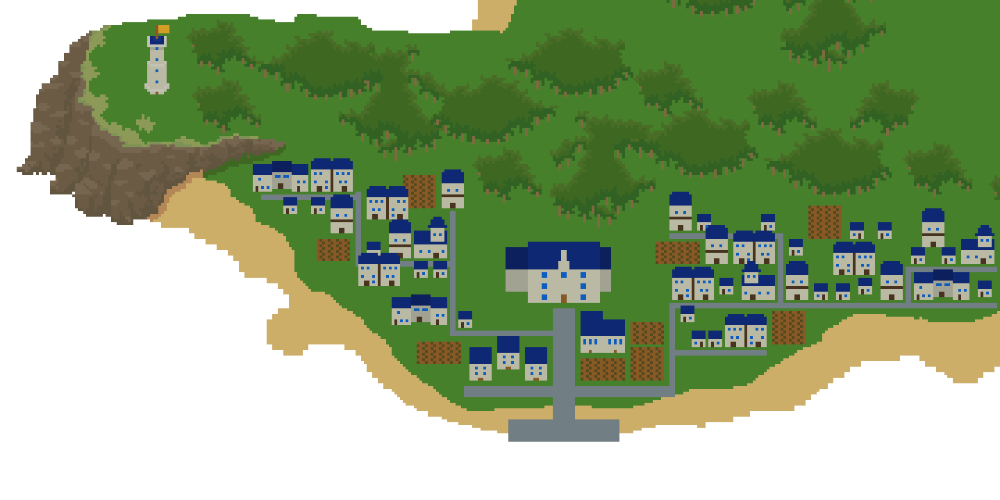
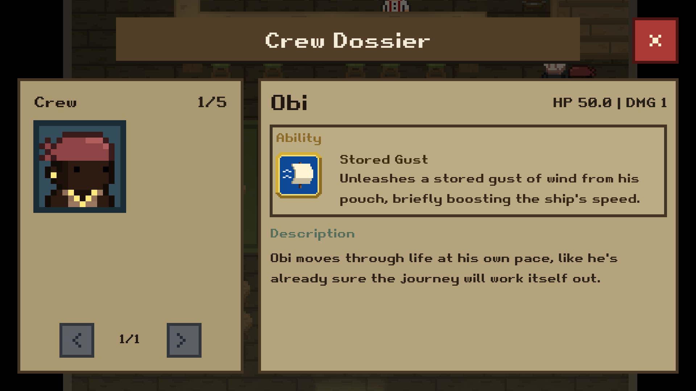
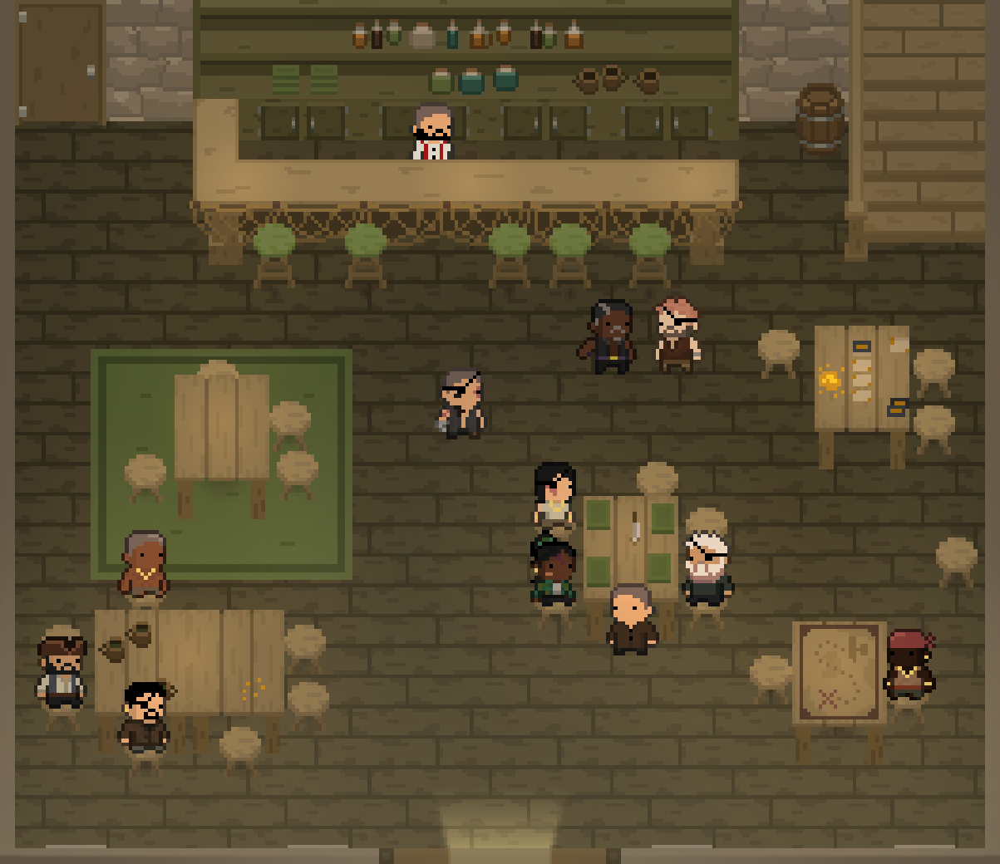
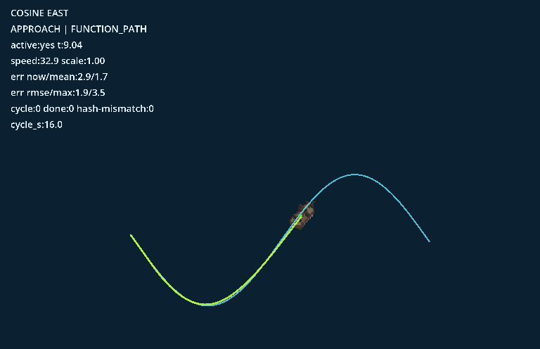

# Development Update 1

> Posted **March 30, 2026** by Captain Rubin. Development update from sealubbers.com.

Ahoy Mateys.

I owe you an apology. About six months ago I said the Sealubbers demo would release by the end of
2025. That obviously didn't happen. On top of that, I've been pretty quiet for the last few months,
which only made things worse.

The truth is that development has taken much longer than I expected. This project is far bigger than
anything I've worked on before, and I reached a point where my original systems just weren't scaling
well, so a lot of the core had to be redesigned and rebuilt. I also spent months stuck on enemy AI,
which turned out to be much more complex than anything I'd tackled before. Because of all that, I
didn't want to release a demo that felt half-finished or misrepresent what the game is supposed to be.

I also don't want to make another promise I can't keep. Because of that, I'm not announcing a new
release date for the demo right now. When I give a date next time, I want to be absolutely sure I can
hit it.

What I can say is that the project is still very much alive, and I've been working on it obsessively
behind the scenes. Let me show you what I've been working on; I'm very excited about how it's turning
out.

## Recent progress

### New islands

I created drafts for two new islands.

- **Port Abera** — a Royal Navy outpost known for its wealth. At its center, the governor is working
  to outgrow the crown itself, eliminating piracy in the region while exploiting every resource he can
  to build his own power. Through strict trade control and relentless naval expansion, he is turning
  the port into a foundation for influence that may soon rival the navy's command. *(This is still an
  early sketch, it will look much nicer.)*
- **Blubberig** — a Pirate Fleet outpost built around a colossal whale carcass. It began as a chaotic
  scramble between rival crews racing to strip it for oil and bone. No one could claim it, and no one
  would leave, so the scaffolding became permanent. With no ruler and constant infighting, control
  shifts between factions, but the value of the whale binds them all to the same fragile stronghold.

### Crew and characters

I added 20 unique crew mates with their own combat abilities and dialogue. I also finished the hiring
system. When you recruit someone, they run to your ship, get added to your crew dossier, and appear
onboard doing idle activities. They now affect your ship's stats and appear during boarding battles.

The crew dossier now lets you flip through your recruits, view their stats, read their descriptions,
and see the unique ship or combat ability each crew mate brings with them.

### Taverns and NPCs

The Kelptown Inn has been completely redone and now includes a lighting system. NPCs in taverns now
move around, sit at tables, and converse with each other instead of standing still. I'm really happy
with how this turned out, it's at the level of polish I'm going for with the game.

### Quests

The quest system is finished. You can receive quests through dialogue or the task board, look at the
details in the quest log, and then track a quest on screen. The first quest type is exploration, where
you chart your map and get guided toward new islands. I'll be working on bounties next, where you hunt
down valuable ships.

### Menus and UI

Core menus are now in place. This includes the task board, world map, crew dossier, quest log, and
settings.

### Ship movement and AI

I built a system where ships follow mathematical functions as paths. This allows them to move in more
natural and varied ways. With this system, your ship can autopilot around obstacles when docking and
move in a smooth, natural route. Enemy ships can evade, navigate around hazards, and position
themselves for broadsides more reliably.

This debug view shows one of the mathematical routes ships can follow, letting them sail along smoother
curves and approach targets with more natural movement.

### Combat and loot

Defeated ships now break apart into loot. Gold and items scatter into the water and you sail over to
collect them. Boarding combat has also been improved. Your crew fights automatically in a way that
looks natural. Then you can move them around and use their special abilities as the captain. There is
also a victory screen for these fights too. I'm still working on balancing the difficulty of these
battles and adding environmental interactions.

When you sail over floating gold, it now flies up into the HUD so collecting loot feels very
satisfying.

### World detail and feel

I added rocks and coral to the ocean to break up empty space. I also adjusted sound and controls based
on feedback to improve how the game feels.

## Looking ahead

Once I rebuilt a lot of the core systems, development started moving much faster. It's now much easier
to add new features and expand the game without everything breaking. There's still a lot left to do,
especially with combat and artwork, but progress is going very steadily.

Sealubbers is a large project for one person, and sometimes that means progress happens slower than
I'd like. But I'm very committed to making the game the right way instead of rushing something out
that doesn't live up to what it should be.

Going forward I'm going to try to share more frequent updates so you can see what's being worked on,
even when things are rough.

Thank you to everyone who's stuck around and continues to support the project. It genuinely means a
lot.

More updates soon.
